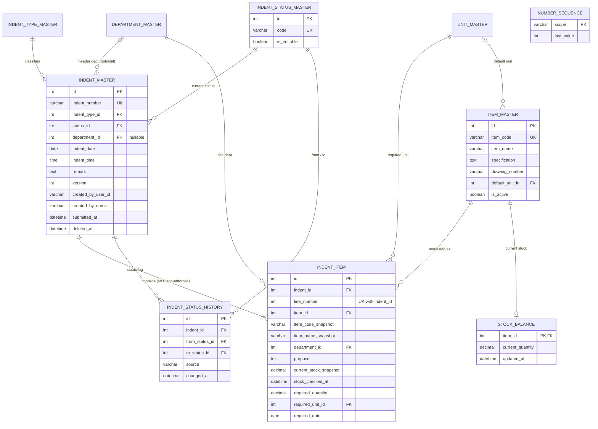

# Organize Indent System: Final Data Model (MySQL 8 + Prisma)

**Version:** 1.0 (final proposal for team and company review)
**Date:** 2026-10-29
**Inputs:** SRS v1.0 (8 Sep 2026), industry schema v0.1, my earlier review (`../schema-vs-srs-review.md`)
**Target:** MySQL ≥ 8.0.16, Prisma 6, Next.js (SSR)
**Companion files:** [`schema.prisma`](../../client/prisma/schema.prisma) and [`migration.sql`](../../client/prisma/migrations/0001_init/migration.sql)

> **Ownership:** this document is owned by the DB teammate. App-side requests and overrides go in [`db-handoff.md`](db-handoff.md), not in this file. Do not edit this file without the DB owner.

> Nothing in the repository has been changed. The schema was checked with `prisma validate` and the DDL was generated with `prisma migrate diff` (Prisma 6). It has **not** been run against a live MySQL server, because none was available in this environment. Run `prisma migrate dev` once on a local MySQL 8 before you rely on it.

---

## 1. Summary

The model has **10 tables**: 4 reference masters, the item catalogue, a stock stand-in, the indent header and lines, status history, and a number counter.

| Table | Purpose | SRS source |
|---|---|---|
| `unit_master` | Units of measure | 8.2 Unit, 15.1 |
| `department_master` | Departments | 7.4, 15.1 |
| `indent_type_master` | Indent types | 7.3, 15.1 |
| `indent_status_master` | Status values, as data | 7.9, FR-13 |
| `item_master` | Item catalogue, auto item code | 8.3–8.5, FR-06 |
| `stock_balance` | Current stock per item (stand-in for Inventory DB) | 9.x, 15.1 Stock, FR-07 |
| `number_sequence` | Concurrency-safe counters for indent number and item code | FR-02, FR-06 |
| `indent_master` | Indent header | 7.1, FR-03 |
| `indent_item` | Indent lines | 8.2, 15.1 Indent Item |
| `indent_status_history` | Append-only log of status changes | 4.2, UC-04 |

Every confirmed SRS requirement is supported. Every TBD item can be resolved **by inserting data or changing service config**, except three that need a small migration if the company answers a certain way (listed in §9).

---

## 2. Entity relationship diagram



Legacy name mapping, for future ERP integration: `ItemMaster → item_master`, `IndentMaster → indent_master`, `IndentDetailMaster → indent_item`, `IndentTypeMaster → indent_type_master`.

---

## 3. Final Prisma schema

This is identical to [`schema.prisma`](../../client/prisma/schema.prisma). Field-level reasoning is in the decision log (§5).

```prisma
generator client {
  provider = "prisma-client-js"
}

datasource db {
  provider = "mysql"
  url      = env("DATABASE_URL")
}

model Unit {
  id        Int      @id @default(autoincrement())
  code      String   @unique @db.VarChar(20)
  name      String   @db.VarChar(80)
  symbol    String?  @db.VarChar(20)
  isActive  Boolean  @default(true) @map("is_active")
  createdAt DateTime @default(now()) @map("created_at")
  updatedAt DateTime @updatedAt @map("updated_at")

  items Item[]
  lines IndentItem[]

  @@map("unit_master")
}

model Department {
  id        Int      @id @default(autoincrement())
  code      String   @unique @db.VarChar(30)
  name      String   @db.VarChar(150)
  isActive  Boolean  @default(true) @map("is_active")
  createdAt DateTime @default(now()) @map("created_at")
  updatedAt DateTime @updatedAt @map("updated_at")

  indents Indent[]
  lines   IndentItem[]

  @@map("department_master")
}

model IndentType {
  id          Int      @id @default(autoincrement())
  code        String   @unique @db.VarChar(30)
  name        String   @db.VarChar(100)
  description String?  @db.VarChar(500)
  isActive    Boolean  @default(true) @map("is_active")
  createdAt   DateTime @default(now()) @map("created_at")
  updatedAt   DateTime @updatedAt @map("updated_at")

  indents Indent[]

  @@map("indent_type_master")
}

model IndentStatus {
  id         Int      @id @default(autoincrement())
  code       String   @unique @db.VarChar(30)
  name       String   @db.VarChar(80)
  sortOrder  Int      @default(0) @map("sort_order")
  isEditable Boolean  @default(false) @map("is_editable")
  isActive   Boolean  @default(true) @map("is_active")
  createdAt  DateTime @default(now()) @map("created_at")

  indents     Indent[]
  historyFrom IndentStatusHistory[] @relation("HistoryFrom")
  historyTo   IndentStatusHistory[] @relation("HistoryTo")

  @@map("indent_status_master")
}

model Item {
  id              Int      @id @default(autoincrement())
  itemCode        String   @unique @map("item_code") @db.VarChar(50)
  itemName        String   @map("item_name") @db.VarChar(255)
  specification   String?  @db.Text
  drawingNumber   String?  @map("drawing_number") @db.VarChar(100)
  defaultUnitId   Int?     @map("default_unit_id")
  isActive        Boolean  @default(true) @map("is_active")
  createdAt       DateTime @default(now()) @map("created_at")
  createdByUserId String?  @map("created_by_user_id") @db.VarChar(64)
  updatedAt       DateTime @updatedAt @map("updated_at")

  defaultUnit Unit?          @relation(fields: [defaultUnitId], references: [id])
  stock       StockBalance?
  lines       IndentItem[]

  @@index([isActive, itemName])
  @@index([defaultUnitId])
  @@map("item_master")
}

model StockBalance {
  itemId          Int      @id @map("item_id")
  currentQuantity Decimal  @map("current_quantity") @db.Decimal(18, 4)
  updatedAt       DateTime @map("updated_at")

  item Item @relation(fields: [itemId], references: [id])

  @@map("stock_balance")
}

model NumberSequence {
  scope     String   @id @db.VarChar(64)
  lastValue Int      @default(0) @map("last_value")
  updatedAt DateTime @updatedAt @map("updated_at")

  @@map("number_sequence")
}

model Indent {
  id                Int       @id @default(autoincrement())
  indentNumber      String    @unique @map("indent_number") @db.VarChar(30)
  indentTypeId      Int       @map("indent_type_id")
  statusId          Int       @map("status_id")
  departmentId      Int?      @map("department_id")
  indentDate        DateTime  @map("indent_date") @db.Date
  indentTime        DateTime  @map("indent_time") @db.Time(0)
  remark            String?   @db.Text
  version           Int       @default(1)
  createdAt         DateTime  @default(now()) @map("created_at")
  createdByUserId   String    @map("created_by_user_id") @db.VarChar(64)
  createdByName     String    @map("created_by_name") @db.VarChar(150)
  updatedAt         DateTime  @updatedAt @map("updated_at")
  updatedByUserId   String?   @map("updated_by_user_id") @db.VarChar(64)
  submittedAt       DateTime? @map("submitted_at")
  submittedByUserId String?   @map("submitted_by_user_id") @db.VarChar(64)
  deletedAt         DateTime? @map("deleted_at")
  deletedByUserId   String?   @map("deleted_by_user_id") @db.VarChar(64)

  indentType IndentType            @relation(fields: [indentTypeId], references: [id])
  status     IndentStatus          @relation(fields: [statusId], references: [id])
  department Department?           @relation(fields: [departmentId], references: [id])
  items      IndentItem[]
  history    IndentStatusHistory[]

  @@index([indentDate, id])
  @@index([statusId, indentDate])
  @@index([indentTypeId, indentDate])
  @@index([departmentId, indentDate])
  @@index([createdByUserId, indentDate])
  @@map("indent_master")
}

model IndentItem {
  id                    Int       @id @default(autoincrement())
  indentId              Int       @map("indent_id")
  lineNumber            Int       @map("line_number")
  itemId                Int       @map("item_id")
  itemCodeSnapshot      String    @map("item_code_snapshot") @db.VarChar(50)
  itemNameSnapshot      String    @map("item_name_snapshot") @db.VarChar(255)
  specificationSnapshot String?   @map("specification_snapshot") @db.Text
  drawingNumberSnapshot String?   @map("drawing_number_snapshot") @db.VarChar(100)
  departmentId          Int       @map("department_id")
  purpose               String?   @db.Text
  currentStockSnapshot  Decimal?  @map("current_stock_snapshot") @db.Decimal(18, 4)
  stockCheckedAt        DateTime? @map("stock_checked_at")
  requiredQuantity      Decimal   @map("required_quantity") @db.Decimal(18, 4)
  requiredUnitId        Int       @map("required_unit_id")
  requiredDate          DateTime  @map("required_date") @db.Date
  createdAt             DateTime  @default(now()) @map("created_at")
  createdByUserId       String?   @map("created_by_user_id") @db.VarChar(64)
  updatedAt             DateTime  @updatedAt @map("updated_at")
  updatedByUserId       String?   @map("updated_by_user_id") @db.VarChar(64)

  indent       Indent     @relation(fields: [indentId], references: [id], onDelete: Cascade)
  item         Item       @relation(fields: [itemId], references: [id])
  department   Department @relation(fields: [departmentId], references: [id])
  requiredUnit Unit       @relation(fields: [requiredUnitId], references: [id])

  @@unique([indentId, lineNumber])
  @@index([itemId])
  @@index([departmentId])
  @@index([requiredUnitId])
  @@map("indent_item")
}

model IndentStatusHistory {
  id              Int      @id @default(autoincrement())
  indentId        Int      @map("indent_id")
  fromStatusId    Int?     @map("from_status_id")
  toStatusId      Int      @map("to_status_id")
  changedAt       DateTime @default(now()) @map("changed_at")
  changedByUserId String?  @map("changed_by_user_id") @db.VarChar(64)
  source          String   @db.VarChar(20)
  note            String?  @db.VarChar(500)

  indent     Indent        @relation(fields: [indentId], references: [id], onDelete: Cascade)
  fromStatus IndentStatus? @relation("HistoryFrom", fields: [fromStatusId], references: [id])
  toStatus   IndentStatus  @relation("HistoryTo", fields: [toStatusId], references: [id])

  @@index([indentId, changedAt])
  @@index([fromStatusId])
  @@index([toStatusId])
  @@map("indent_status_history")
}
```

---

## 4. Hand-written migration SQL

Prisma generates the tables, keys, indexes and FKs (the full output is in [`migration.sql`](../../client/prisma/migrations/0001_init/migration.sql)). Append the following to the first migration. Create it with `prisma migrate dev --create-only --name init`, paste this at the end, then run `prisma migrate dev`.

```sql
-- Requires MySQL >= 8.0.16 (CHECK is parsed but ignored before that).
ALTER TABLE `indent_item`
    ADD CONSTRAINT `ck_indent_item_line_number` CHECK (`line_number` > 0),
    ADD CONSTRAINT `ck_indent_item_required_qty` CHECK (`required_quantity` > 0);
ALTER TABLE `indent_master`
    ADD CONSTRAINT `ck_indent_master_version` CHECK (`version` >= 1);
ALTER TABLE `number_sequence`
    ADD CONSTRAINT `ck_number_sequence_last_value` CHECK (`last_value` >= 0);
ALTER TABLE `indent_status_history`
    ADD CONSTRAINT `ck_status_history_source` CHECK (`source` IN ('APP','APPROVAL','SYSTEM'));

INSERT INTO `indent_status_master` (`code`,`name`,`sort_order`,`is_editable`,`is_active`)
VALUES ('DRAFT','Draft',10,TRUE,TRUE), ('SUBMITTED','Submitted',20,FALSE,TRUE);

INSERT INTO `number_sequence` (`scope`,`last_value`,`updated_at`)
VALUES ('INDENT',0,CURRENT_TIMESTAMP(3)), ('ITEM',0,CURRENT_TIMESTAMP(3));
```

Create the database itself with an explicit charset:

```sql
CREATE DATABASE indent CHARACTER SET utf8mb4 COLLATE utf8mb4_0900_ai_ci;
```

Use `utf8mb4_unicode_ci` instead if the company's server is MariaDB, which lacks the 0900 collations.

---

## 5. Decision log

Each entry gives the decision, the alternatives considered, why I chose it, and what it costs. "Revisit if" says which company answer would reopen it.

### A. Platform and conventions

**D-01. Integer auto-increment primary keys, not UUIDs.**
*Alternatives:* UUID v4 `CHAR(36)` as in v0.1; UUID v7; `BINARY(16)`; `BigInt`.
*Why:* InnoDB clusters rows by primary key. Random v4 keys cause page splits and make every secondary index carry 36 bytes per row. MySQL has no `gen_random_uuid()`. `BINARY(16)` maps to Prisma `Bytes`, which is awkward everywhere in the app. `BigInt` cannot be passed through `JSON.stringify`, which Next.js SSR props depend on. `INT` (2.1 billion rows) is far beyond any indent volume.
*Cost:* IDs are guessable. That is acceptable because every read is authorization-checked (NFR-09) and URLs use `indent_number` (D-11). IDs from two databases would collide on a future ERP merge, which is why the business keys (`indent_number`, `item_code`, master `code`) are unique and act as the integration keys (D-28).
*Revisit if:* the company mandates UUIDs. Then use `String @id @default(uuid(7)) @db.Char(36)`.

**D-02. snake_case tables and columns, camelCase in Prisma.**
`@@map` and `@map` on every model and field. The SQL reads like the industry document and the legacy tables, while TypeScript stays idiomatic. Masters keep the `_master` suffix for continuity with the legacy names. Lines are called `indent_item` because that is the SRS term (15.1 "Indent Item"); the legacy `IndentDetailMaster` name is kept only in the mapping table above.

**D-03. All instants are `DATETIME(3)` in UTC.**
*Alternatives:* `TIMESTAMP` (session-timezone converted, ends 2038-01-19).
*Why:* Prisma maps `DateTime` to `DATETIME(3)` and always reads and writes it as UTC, whatever the server timezone. `TIMESTAMP` would add hidden conversion and a 2038 limit. Set both the DB server and the Node process to UTC so raw SQL and Prisma agree.
*Applies to:* `created_at`, `updated_at`, `submitted_at`, `deleted_at`, `stock_checked_at`, `changed_at`.

**D-04. Business date and time are separate `DATE` and `TIME(0)` columns in company local time.**
*Alternatives:* one `indent_at DATETIME` in UTC.
*Why:* The SRS lists Date and Time as two separate indent fields (7.1, FR-03, 11.2), and the Date and Date Range filters work on calendar dates. With a UTC instant, "indents on 29 Oct" would need timezone-shifted range queries and would break on any timezone change. A `DATE` column makes the filter a plain indexed equality or range.
*Cost:* `indent_date` and `indent_time` do not identify an instant without the company timezone. `created_at` (UTC) remains the true instant. Prisma returns `@db.Time` as a `Date` on 1970-01-01, so format only the time part. Build `DATE` values as UTC midnight (`new Date('2026-10-29')`), never from a local `Date`, or a day can be lost.
*Config:* one `APP_TIMEZONE` setting (company to confirm, e.g. `Asia/Kolkata`). The service defaults date and time from "now" in that timezone.

**D-05. `@updatedAt` for `updated_at`, not a DB `ON UPDATE` clause.**
Prisma sets it on every Prisma write. Raw SQL updates will not bump it. The only raw SQL in the design is reads, so this is acceptable. A DB-side `ON UPDATE CURRENT_TIMESTAMP(3)` would cause Prisma to report schema drift.

**D-06. `DECIMAL(18,4)` for quantities.**
This is exact (no float rounding), and 4 decimal places cover kg and litre fractions. Prisma returns `Decimal.js`. Convert it to a string at the API boundary, and write it as a number cell in Excel (§6.7).

**D-07. CHECK constraints in hand-written migration SQL, and duplicated in app validation.**
Prisma has no CHECK syntax and does not detect them as drift. CHECKs are only enforced from MySQL 8.0.16, so the minimum version is a hard requirement. App validation (e.g. zod) runs first so users see friendly messages (FR-22). The DB check is the last line of defence.
*Deliberately not added:* min/max quantities, date ranges, or `current_stock >= 0`. SRS 12.1 says limits must not be invented. Stock can legitimately be negative in some ERPs.

**D-08. No MySQL `ENUM` and no Prisma `enum` anywhere.**
Every set of values that the company or another team may change (status, type, unit, department) is a row in a lookup table. Adding a value is then an `INSERT`, not a migration. The one fixed set, `indent_status_history.source`, is a `VARCHAR` with a CHECK. That is still easier to extend than an `ENUM`, which needs a table rebuild in MySQL.

**D-09. No database triggers.**
*Considered:* a `BEFORE UPDATE` trigger to block changes to immutable header columns (BR-06).
*Why not:* trigger creation needs `SUPER` or `log_bin_trust_function_creators` on many managed MySQL hosts. Prisma also cannot see trigger logic, and rules would be split across two places. Immutability is enforced in the indent service, which is the only writer (§6.4).

**D-10. Foreign key actions.**
Lines and status history use `onDelete: Cascade` to their header, because they are owned by it. Everything else is `Restrict` (the Prisma default for required relations), so a master row in use cannot be deleted. Masters are deactivated (`is_active = false`) instead of deleted. Deactivated rows stay valid for history but are hidden from pickers for new indents.

### B. Indent header (`indent_master`)

**D-11. `indent_number` is a separate, unique business key.**
`VARCHAR(30)` gives room for any reasonable format (e.g. `PURC000123` is 10 characters). It stays UNIQUE across soft-deleted rows, so a number is never reused (D-17). It is the identifier shown to users and used in URLs and exports.

**D-12. Indent number and item code come from a counter table (`number_sequence`).**
*Alternatives:* `MAX()+1` (races and produces duplicates); an AUTO_INCREMENT id formatted as the number (simple, but gaps on rollback and no per-year reset); UUID-style codes (not human friendly).
*How:* the row for the scope is seeded. Inside the save transaction, Prisma `update({ where:{scope}, data:{ lastValue:{ increment:1 } } })` issues one `UPDATE … SET last_value = last_value + 1`. InnoDB holds that row lock until commit, so a concurrent save waits and then gets the next value. If the save rolls back, the counter rolls back too, so **numbers are gap-free**. The format (prefix, padding, year) is applied in code from config, because the format is TBD (7.2). The UNIQUE key on `indent_number` is the backstop: on Prisma error `P2002`, retry once.
*Cost:* all indent creations serialize on one row for the rest of their transaction. To keep that window tiny, take the number as the **last** step before the header insert. At indent volumes this cost is negligible.
*Do not* use `upsert` for the counter. Prisma may run it as select-then-insert on MySQL, which can race. That is why rows are seeded in the migration.
*Per-period reset:* if the format resets yearly or per type, the service uses a scope like `INDENT:2026` or `INDENT:PURC:2026` and inserts that row on first use with `INSERT IGNORE` before the increment.

**D-13. Number shown "on save", not when the form opens.**
UC-01 step 2 says the system generates the number when Create opens. A number cannot be both gap-free and handed out before the user commits: abandoned forms would burn numbers. The design assumes the form shows "Assigned on save" and the number appears in the confirmation.
*Revisit if:* the company insists on showing it up front. Then increment in its own short transaction when the form opens, and accept gaps. No schema change is needed.

**D-14. Status is a single FK to `indent_status_master`, with an `is_editable` flag.**
*Alternatives:* a Prisma enum (needs a migration for every new approval status); two columns, our lifecycle plus an approval status code (more flexible, but the Status filter becomes a two-column predicate and the UI must merge them).
*Why:* SRS FR-13 has one "Status" filter, and 7.9 lists one sequence of values. The approval team will own most values, so they are rows. `is_editable` turns the TBD rule "status that permits modification" (8.11, 7.10) into data. Today only `DRAFT` is editable. If the company says Submitted indents allow some edits, flip a flag. The service only hard-codes the two codes this module owns: `DRAFT` and `SUBMITTED`.
*Revisit if:* the approval team keeps its own status and only sends events. Then add `approval_status_code` and keep `status_id` for our lifecycle.

**D-15. `indent_status_history`, an append-only status log.**
One row per transition, with `source` = `APP` (our save/submit), `APPROVAL` (pushed by the approval team) or `SYSTEM`. *Why:* the hand-off at Submit crosses a team boundary. When a status looks wrong, this is the only way to tell who changed it and when. It is cheap (one insert per transition) and is not an approval workflow, so it stays inside scope (SRS 3.2). The current status stays denormalized on the header for fast filtering.

**D-16. Header `department_id` is nullable; line `department_id` is required.**
The SRS puts Department on both the indent (7.1, FR-03, 11.2) and the item (8.2, 15.1), and marks mandatory-ness TBD. *Rule in service:* the header department defaults onto each new line, and the user may override it per line. The line column is always filled. This works for all three possible answers. If header-only, lines just copy it. If line-only, the header stays null. If both, it already works.
*Department filter (FR-13):* matches when the header **or any line** has that department: `OR: [{ departmentId }, { items: { some: { departmentId } } }]`. Both columns are indexed.
*Revisit if:* the company confirms the header department is mandatory. Then make it `NOT NULL` with a one-line migration.

**D-17. Soft delete for headers (`deleted_at`, `deleted_by_user_id`), hard delete for lines.**
*Why headers are soft:* a deleted indent might already have been seen or exported, and the number must never be reused (D-11). *Why lines are hard:* line deletion is a draft-editing action (FR-17, 8.11), and the number collision problem disappears. MySQL has no partial unique indexes, and `UNIQUE(indent_id, line_number, deleted_at)` does not work because MySQL allows any number of NULLs in a unique index.
*Implementation:* a Prisma client extension adds `deletedAt: null` to every `indent` read, so no query can forget it.
*Revisit if:* the company requires an audit of deleted lines. Then add an `indent_item_audit` table rather than soft-deleting lines.

**D-18. Created By is an opaque external ID plus a name snapshot.**
`created_by_user_id VARCHAR(64)` takes any identity format (UUID, numeric, or a provider subject), because the auth module's ID type is unknown (SRS 2.5). `created_by_name` makes the list, the Created By filter dropdown and Excel export work without calling the auth module per row. There is no FK because there is no local user table, and user management is out of scope.
*Cost:* if a user is renamed, old indents show the old name. That is correct for a request document.
*Filter dropdown:* `SELECT DISTINCT created_by_user_id, created_by_name` over indents the viewer can see.

**D-19. `version` for optimistic locking, bumped on any change to the indent or its lines.**
Prisma has no `@version`, so every write does `updateMany({ where: { id, version: v }, data: { version: { increment: 1 }, … } })` first. `count === 0` means someone else changed it. The UI then shows a conflict dialog and reloads. Line edits and approval status pushes also bump the header version, so one number guards the whole document. That header update also takes the row lock that serializes line numbering (D-22) and the "at least one item" check (D-23).

**D-20. Immutable header attributes are enforced in the service.**
After the first save, only `status_id`, `version`, `updated_*`, `submitted_*` and `deleted_*` may change. Type, date, time, department, remark and number are frozen (BR-06, 7.7). The update service has no code path that writes them. A unit test asserts this.
*Note for the company:* this means a typo in the remark cannot be fixed even in Draft. Section 9 asks them to confirm that.

### C. Lines (`indent_item`)

**D-21. Lines link to the item and also snapshot it.**
`item_id` is the real link, used for stock lookup and reporting. `item_code_snapshot`, `item_name_snapshot`, `specification_snapshot` and `drawing_number_snapshot` freeze what the requester saw. Without them, renaming an item would silently change submitted indents.
*Rule:* the code snapshot is **read-only**. SRS 8.10 lists Item Code as possibly editable, but stock is looked up by item code (FR-07), so a line whose code differs from its item would break that link. To change the item, the user picks a different item, which refreshes all snapshots.

**D-22. `line_number` is unique per indent, assigned as max+1 under the header lock, with gaps allowed.**
*Revised from my earlier proposal:* I previously added a `next_line_no` counter on the header. That is unnecessary. Lines are hard-deleted (D-17), so reusing a number cannot collide, and the version update (D-19) already locks the header row, so `MAX(line_number)+1` read afterwards in the same transaction is race-free. One less column to keep in sync. Gaps after deletion are harmless: `line_number` gives stable ordering, and the UI shows a row index.

**D-23. "At least one item" is enforced in the service, inside the transaction.**
A database cannot enforce "≥1 child" without triggers (D-09). Two guards cover it: on save, reject an empty `items` array (FR-08, BR-01); on line delete, after locking the header (D-19), count the remaining lines and roll back if it would hit zero.

**D-24. Duplicate items in one indent are allowed by the schema.**
BR-09 is TBD (prevent, combine, or allow). Allowing is the only option that does not need a later migration to undo. If the answer is "prevent", add `@@unique([indentId, itemId])`, which is safe because lines are hard-deleted. If "combine", the service merges quantities and no schema change is needed.

**D-25. Stock is a snapshot on the line plus a separate `stock_balance` table.**
`current_stock_snapshot` and `stock_checked_at` record what the user saw (SRS 15.1 "Indent Item: current_stock"). `stock_balance` is the stand-in for the Inventory/Stock DB (9.2, 15.1 "Stock"). It is keyed 1:1 by `item_id` (its PK). Item Code is unique on the item, so this is the same as the SRS's "via Item Code" relation, but cheaper to join and safe from code changes.
*Staleness (9.4, 9.6):* stale means `stock_balance.updated_at > line.stock_checked_at`. That uses one indexed lookup and no invented "source version" (dropped from v0.1).
*BR-04:* the indent service never writes `stock_balance`. Code accesses stock through a `StockProvider` interface so it can later point at the real Inventory DB or ERP without changing anything else (NFR-08).
*Revisit if:* stock lives in a separate company database from day one. Then drop `stock_balance` and implement the provider against it. Line columns are unchanged.

**D-26. `purpose` and `department` live on the line, not the item.**
SRS 15.1 lists them under "Item", but they describe a particular request, not the catalogue item. The same bolt can be requested by Maintenance for one reason and by Production for another. The SRS itself warns that 15.1 is "a logical starting point only".

### D. Item catalogue

**D-27. Item master trimmed to the SRS fields.**
`item_code`, `item_name`, `specification`, `drawing_number`, `default_unit_id`, `is_active` (SRS 8.2, 8.5). *Removed from v0.1:* `description`, `material`, `item_type`, `hsn_code`, `gst_rate`, which are commercial or legacy fields with no SRS requirement. Adding a nullable column later is a trivial migration, while removing a column that has data is not.
*Item Code (FR-06, BR-03):* generated from `number_sequence` scope `ITEM`, using the same mechanism as D-12. Unique and case-insensitive under the default collation.
*New items from the indent form:* created **inside the same save transaction** as the indent. An abandoned draft then leaves no orphan items, and item code numbering stays gap-free. Until save, the grid holds a "new item" placeholder. A new item has no stock row, so its stock shows "not available" rather than 0.
*Item name:* not unique. The SRS does not say it is, and two drawings can share a name. The `(is_active, item_name)` index supports the picker.

**D-28. No `external_ref` columns on masters (yet).**
*Considered:* adding ERP reference IDs now for NFR-08. *Why not:* the ERP's key format is unknown, and every master already has a unique business `code`, which is the natural join key for a future sync. Adding a column later is cheap; guessing its type now is not. NFR-08 is met at the code level by the repository and provider interfaces, not by extra columns.

### E. Querying

**D-29. Indexes match the SRS filters exactly.**
Default list order is `indent_date DESC, id DESC`, indexed as `(indent_date, id)`; MySQL 8 scans it backwards. Each filter in FR-13 has a composite index led by its column with `indent_date` second, so a filter plus date range plus sort is one index range scan: `(status_id, indent_date)`, `(indent_type_id, indent_date)`, `(department_id, indent_date)`, `(created_by_user_id, indent_date)`. Line-side `department_id` supports the "any line" department filter. MySQL has no partial indexes, so v0.1's `WHERE is_active` index became `(is_active, item_name)`.

**D-30. Offset pagination with a count.**
FR-15 and 10.5 require 10 rows per page with page numbers, which keyset pagination cannot provide. Use `skip/take` plus `count()` in one `$transaction`. With the indexes above this is fast well into tens of thousands of indents. The stable tiebreak on `id` prevents rows from moving between pages.

**D-31. Search by indent number uses `LIKE`, not FULLTEXT.**
Exact or partial is TBD (BR-13). Prisma `equals` hits the unique index, `startsWith` becomes `LIKE 'x%'` and uses the index, and `contains` becomes `LIKE '%x%'`, a scan that is fine at indent volumes. InnoDB FULLTEXT treats `PURC000123` as one token and ignores short tokens, so it would not help. The default collation is case-insensitive, so no `mode: 'insensitive'` is needed (Prisma does not support that option on MySQL anyway).
*Item picker:* `startsWith` or `contains` on `item_code` and `item_name`. Add a `FULLTEXT ... WITH PARSER ngram` index by raw SQL only if the catalogue grows large.

---

## 6. How the service uses the model

Sketches only, to show the schema is workable. These are not final code.

### 6.1 Number generation

```ts
async function nextNumber(tx: Prisma.TransactionClient, scope: string): Promise<number> {
  const row = await tx.numberSequence.update({
    where: { scope },
    data: { lastValue: { increment: 1 } },
  }); // row lock held until commit
  return row.lastValue;
}
const formatIndentNumber = (n: number) => `${cfg.indentPrefix}${String(n).padStart(cfg.indentPad, "0")}`; // format TBD
```

### 6.2 Save a new indent as Draft (UC-01, UC-03)

```ts
await prisma.$transaction(async (tx) => {
  if (input.items.length < 1) throw new AppError("INDENT_EMPTY");           // FR-08
  await assertActiveMasters(tx, input);                                    // type, departments, units
  const draft = await tx.indentStatus.findUniqueOrThrow({ where: { code: "DRAFT" } });
  const lines = await resolveLines(tx, input.items, user);                 // creates new items (ITEM sequence),
                                                                           // snapshots item fields + stock
  const indentNumber = formatIndentNumber(await nextNumber(tx, "INDENT")); // last step before insert (D-12)
  const indent = await tx.indent.create({
    data: {
      indentNumber, indentTypeId: input.typeId, statusId: draft.id, departmentId: input.departmentId ?? null,
      indentDate: input.date, indentTime: input.time, remark: input.remark,
      createdByUserId: user.id, createdByName: user.name,
      items: { create: lines.map((l, i) => ({ ...l, lineNumber: i + 1, createdByUserId: user.id })) },
      history: { create: { toStatusId: draft.id, source: "APP", changedByUserId: user.id } },
    },
  });
  return indent;
});
```

### 6.3 Edit a line, delete a line, submit (optimistic lock + header lock)

```ts
async function lockForChange(tx, indentId: number, version: number, userId: string) {
  const editable = await editableStatusIds(tx);   // cached ids where is_editable = true
  // Plain column filters only, so Prisma emits one atomic UPDATE (a relation filter would add a pre-SELECT).
  const { count } = await tx.indent.updateMany({
    where: { id: indentId, version, deletedAt: null, statusId: { in: editable } },
    data: { version: { increment: 1 }, updatedByUserId: userId },
  });
  if (count === 0) throw new AppError("INDENT_CONFLICT_OR_LOCKED");        // stale version, or not editable
}

// delete line (FR-17)
await prisma.$transaction(async (tx) => {
  await lockForChange(tx, indentId, version, user.id);
  await tx.indentItem.delete({ where: { id: lineId, indentId } });
  if ((await tx.indentItem.count({ where: { indentId } })) === 0) throw new AppError("INDENT_EMPTY"); // rolls back
});

// add line: after lockForChange, lineNumber = (max line_number) + 1   (D-22)
// submit (UC-04): lockForChange, then set statusId = SUBMITTED, submittedAt/By, insert history row,
// then notify the approval boundary (outbox or API call; contract TBD).
```

Approval status push (from the other team) uses a separate path that ignores `is_editable`. It updates `status_id`, bumps `version`, and writes history with `source = 'APPROVAL'`.

### 6.4 Immutability

The update DTO for an indent contains no header business fields. Only `lockForChange` and the submit, delete and approval paths write to `indent_master`.

### 6.5 Soft-delete extension

```ts
export const db = prisma.$extends({
  query: { indent: {
    async findMany({ args, query }) { args.where = { deletedAt: null, ...args.where }; return query(args); },
    async findFirst({ args, query }) { args.where = { deletedAt: null, ...args.where }; return query(args); },
    async count({ args, query })     { args.where = { deletedAt: null, ...args.where }; return query(args); },
  } },
});
// Look up a single indent by number with findFirst (findUnique cannot take the extra filter).
```

### 6.6 List, filter, paginate (FR-12, FR-13, FR-15)

```ts
const where: Prisma.IndentWhereInput = {
  ...(q && { indentNumber: { contains: q } }),                  // or equals/startsWith once BR-13 is decided
  ...(typeId && { indentTypeId: typeId }),
  ...(statusId && { statusId }),
  ...(createdBy && { createdByUserId: createdBy }),
  ...(from || to ? { indentDate: { gte: from, lte: to } } : {}),
  ...(deptId && { OR: [{ departmentId: deptId }, { items: { some: { departmentId: deptId } } }] }),
  ...visibilityFilter(user),                                     // permission matrix TBD
};
const [total, rows] = await db.$transaction([
  db.indent.count({ where }),
  db.indent.findMany({ where, orderBy: [{ indentDate: "desc" }, { id: "desc" }],
                       skip: (page - 1) * 10, take: 10,
                       include: { indentType: true, status: true, department: true, _count: { select: { items: true } } } }),
]);
```

### 6.7 Excel export (FR-19)

One query shape serves one, many, and all indents: `where: { id: { in: ids } }` or the list filter above, including lines, units and departments. For "all", read in batches of about 500 by `id` cursor and stream the rows into the workbook. Write `Decimal` and `DATE` values as typed numeric and date cells. "Current Stock" in the export is the line snapshot, with its `stock_checked_at`, because that is what the indent recorded. Live stock is a separate column if the company wants it (§9).

---

## 7. Traceability: SRS → model

| SRS | Where it lives |
|---|---|
| FR-01, 05 Create, multiple items | `indent_master` 1:N `indent_item` |
| FR-02, BR-02 Indent number | `indent_number` UNIQUE + `number_sequence` (D-11–13) |
| FR-03 Type, Date, Time, Dept, Created By, Remark | `indent_type_id`, `indent_date`, `indent_time`, `department_id`, `created_by_*`, `remark` |
| FR-04, 8.7 Add Item | client grid, then persisted on save (§6.2) |
| FR-06, BR-03 Item code | `item_master.item_code` + `ITEM` sequence (D-27) |
| FR-07, 9.x Current stock | `stock_balance` + line snapshot (D-25) |
| 9.4, 9.6 Refresh and stale warning | `stock_balance.updated_at` vs `stock_checked_at` |
| BR-04 No stock reduction | service never writes `stock_balance` |
| FR-08, BR-01 ≥1 item | service guard on save and delete (D-23) |
| FR-09, 10, BR-05 Draft and Submit | `status_id`, `submitted_*`, history (D-14, D-15) |
| 7.9 Status display | `indent_status_master` rows |
| 7.7, BR-06 Immutable header | service rule (D-20) |
| 7.10, 8.10, 8.11 Edit rules by status | `is_editable` flag + service field whitelist |
| FR-12, BR-13 Search | `indent_number` UNIQUE index, `LIKE` (D-31) |
| FR-13 Filters | composite indexes (D-29), department OR rule (D-16) |
| FR-14, 10.4 Select | `findFirst` + `include` lines |
| FR-15 10 per page | offset + count (D-30) |
| FR-16 Edit | `version` lock (D-19) |
| FR-17 Delete item | hard delete under lock (D-17, D-23) |
| FR-18 Delete indent | soft delete (D-17) |
| FR-19, 11.2 Excel | all 11.2 columns exist on header and line (§6.7) |
| 8.6, BR-09 Duplicates | allowed now; one-line unique if prevented (D-24) |
| NFR-08 ERP integration | unique business codes, `StockProvider`, no DB-specific features beyond CHECKs (D-28) |
| NFR-09 Authorization | `created_by_user_id` for ownership rules; matrix TBD |
| NFR-10 Integrity | FKs everywhere, CHECKs, Restrict on masters |

---

## 8. Changes from my earlier proposal

Reviewing my own first draft against the SRS led to these changes:

1. **Dropped `next_line_no`** on the header. Hard-deleted lines and the header lock make `MAX+1` safe (D-22).
2. **`stock_balance` keyed by `item_id` as PK**, instead of a surrogate id plus a unique item. A true 1:1 with no extra index.
3. **Added `is_editable`** to statuses, so the TBD "editable while in status X" rules become data (D-14).
4. **Added `indent_status_history`** for the cross-team hand-off (D-15).
5. **Removed the `current_stock >= 0` CHECK**, because the SRS forbids inventing limits (D-07).
6. **Trimmed the item master further**: `description`, `material` and `item_type` are gone as well as HSN/GST (D-27).
7. **Line department stays required, header department nullable**, with a defaulting rule and an OR filter (D-16). Previously the filter semantics were undefined.
8. **New items are created in the indent save transaction**, so abandoned drafts leave no orphan items or burned codes (D-27).
9. **No external-ref columns.** Business codes are the integration keys (D-28).
10. **Added `deleted_by_user_id` and line `created_by` / `updated_by`**, so who-did-what is complete without an audit subsystem.

---

## 9. Open questions that still affect the model

Answers that need **no migration** (data or config only): indent number format, item code format, yearly reset, indent types, departments, units, approval status values, which statuses are editable, search mode, Excel layout, permission matrix, and the duplicate rule if "combine" or "allow".

Answers that **need a small migration**:
1. **Header department mandatory?** If yes, make `department_id NOT NULL`.
2. **Prevent duplicate items?** If yes, add `UNIQUE(indent_id, item_id)`.
3. **Approval team keeps a separate status?** If yes, add `approval_status_code` (D-14).

Business confirmations the design assumes:
4. Show the indent number **on save** rather than when the form opens (D-13).
5. Remark is frozen after the first save, like the other header fields (D-20).
6. Hard delete of draft lines is acceptable with no audit trail of removed lines (D-17).
7. Item Code on a line is **not** editable. Change the item instead (D-21).
8. Stock: is `stock_balance` ours to hold (seeded or synced), or is a company Inventory DB available now (D-25)?
9. Excel "Current Stock": the line snapshot (assumed) or live stock?
10. Company timezone for business dates (D-04), and MySQL ≥ 8.0.16 (or MariaDB) on the target server (D-07).
11. The identity provider's user ID format and maximum length (64 assumed, D-18).
