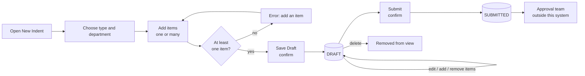

# 2. How it works

## The life of an indent

Plain-language walk-through:

1. **Create.** The user opens *New Indent*. The screen shows an **expected indent number**, read-only. The date, time and "Created by" are filled in by the system, not typed, so they can be trusted.
2. **Add items.** For each item the user picks an existing item or enters a new one (its code is generated automatically), then gives the quantity, unit, required date, purpose and department. The screen shows the **current stock** for that item. Items can be removed before saving.
3. **Save as Draft.** The user confirms. The system checks everything again on the server and stores a **Draft**. The final indent number is confirmed in the success message (it can differ from the expected one only if somebody else saved at the same moment).
4. **Edit while Draft.** The remark and each item's purpose, quantity, date and unit can still be changed, and items added or removed. The indent type, date, time, department and creator **never change** (BR-06).
5. **Submit.** The user confirms. The status becomes **Submitted**, the time and person are recorded, and from then on this system treats the indent as read-only. A one-click **Save & Submit** exists for users who are ready ([DEC-006](../decisions/DEC-006-save-and-submit.md)).
6. **Approval** happens in another team's system. When their statuses arrive, this system will show them.

## The screens

| Screen | What you see | Key points |
|---|---|---|
| **Indent list** | Search box, six filters, table of indents, 10 per page, page numbers | Filters can be combined; the address bar keeps your filters so a view can be shared; click the arrow to see an indent's items without leaving the list |
| **New indent** | Header fields, item entry form, "current item list" | Expected number, read-only date/time/creator, stock shown per item, Save Draft / Save & Submit |
| **Indent detail** | All header fields, all items, actions | Edit, Submit, Delete (Draft only), Print, Export |

Exact fields, buttons and wording: [UI specification](../spec/ui.md).

## Stock: how "current stock" works

- It is **read-only**: the system never changes stock (BR-04).
- When an item is added the current stock is shown. If stock is unknown the screen says **"Not available"** - never a misleading zero.
- When the user presses Save or Submit the system **re-checks** stock. If a figure changed since it was shown, a notice lists "was X, now Y" with an *Update* button. It never blocks saving ([DEC-013](../decisions/DEC-013-stock-freshness.md)).
- The value saved with the indent is the one the **server** read, not a number sent by the browser.

## Search, filters and export

- **Search** matches the indent number: an exact match comes first, then partial matches ([DEC-011](../decisions/DEC-011-indent-search.md)).
- **Filters:** type, department (matches the indent's department or any item's department), date range, created by, status.
- **Export** produces one Excel row per item, with the indent details repeated, covering every field the SRS lists ([export and print](../spec/export-print.md)). The user can export the rows they ticked, or *everything matching the current filters*, limited to what their role may see.
- **Print** prints the complete indent page with a header block (number, status, date, who printed and when).

Next: [03 - Rules and safeguards](03-rules-and-safeguards.md)
