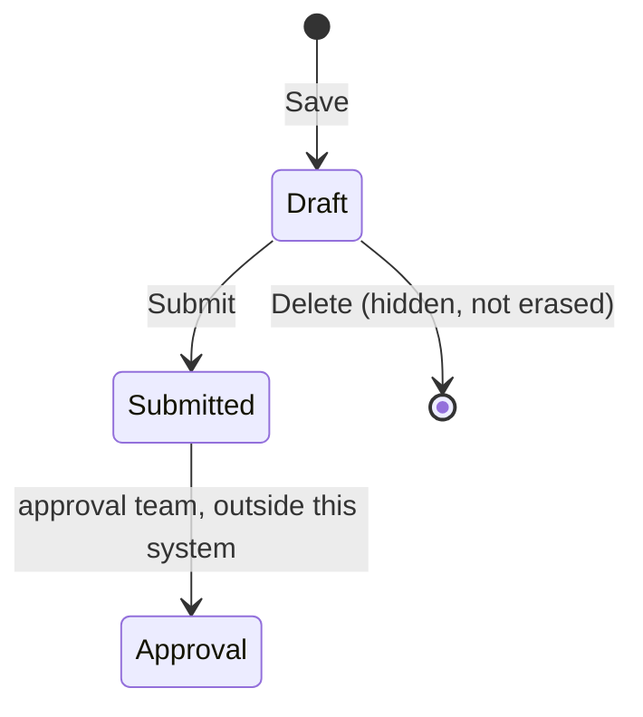

# 3. Rules and safeguards

The point of this page: **the server enforces the rules, not the screen.** The buttons a user sees are only a convenience. Someone calling the system directly meets the same rules.

## Who can do what (provisional)

| Role | See | Create | Edit / Submit / Delete a Draft | Export / Print |
|---|---|---|---|---|
| Department Employee | own indents | yes | own only | own |
| Department Head | their department | yes | their department | their department |
| Purchase / Store Employee | all | no | no | all |
| Admin | all | yes | all | all |

- Anyone not on this list, and anyone not signed in, can do **nothing** ("deny by default").
- This table is **provisional**: the SRS leaves the real permission matrix to the company. Changing it is a one-file change ([permissions](../spec/permissions.md), [DEC-004](../decisions/DEC-004-permission-matrix.md)).
- "Created by" is the signed-in user, taken from the login module. It cannot be typed or changed, so the audit trail is trustworthy.

## Status rules

- Only **Draft** indents can be edited or deleted. **Submitted** indents are read-only here.
- The browser can never set the status. The only way to move an indent forward is the Submit action on the server, and every change is logged with who and when ([DEC-005](../decisions/DEC-005-status-model-and-transitions.md)).
- **Delete is a soft delete:** the indent disappears from lists, search and exports, but its number is never reused and the record is kept ([DEC-008](../decisions/DEC-008-delete-rules.md)).
- An indent can never be left with **no items** (BR-01): saving without items, or deleting the last item, is refused.

## Validation: checked twice, trusted once

The same rules run in the browser (for speed) and on the server (for safety) from one shared definition ([validation](../spec/validation.md)):

- required fields, positive quantities with up to 4 decimals, real calendar dates, required date not before the indent date
- type, department, unit and item must exist and be active
- the same item cannot be added twice to one indent (provisional rule, one switch to change - [DEC-009](../decisions/DEC-009-duplicate-items.md))
- fields the browser must not control (status, creator, number, date, time, stock) are **rejected** if sent

The SRS says not to invent limits (such as a maximum quantity), so none are invented.

## Errors users see

Every failure appears in a dialog with a plain-language message and, for problems on specific fields, the field is marked. Users never see database or technical text. For unexpected problems they see a short reference number; the technical detail is logged for the support team under that same number ([DEC-015](../decisions/DEC-015-error-handling.md)).

## Two people editing at once

Each indent carries a version number. If two people edit the same Draft, the second save is refused with *"This indent was changed by someone else. Reload to see the latest version."* Nothing is silently overwritten ([DEC-016](../decisions/DEC-016-optimistic-locking.md)).

Numbers are allocated safely: two people saving at the same instant get different indent numbers, with no gaps, and a failed save does not use up a number ([DEC-010](../decisions/DEC-010-number-generation-and-preview.md)).

## What is provisional (the SRS says "to be confirmed")

We chose safe defaults and wrote them down. Examples: number formats (`IND-000124`), the permission table, whether duplicates are allowed, which fields are editable, the stock warning, company time zone. The full list with what the system does meanwhile is in [open-questions.md](../open-questions.md); the SRS conflicts we found are in [srs-errata.md](../srs/srs-errata.md).

Next: [04 - Under the hood](04-architecture.md)
