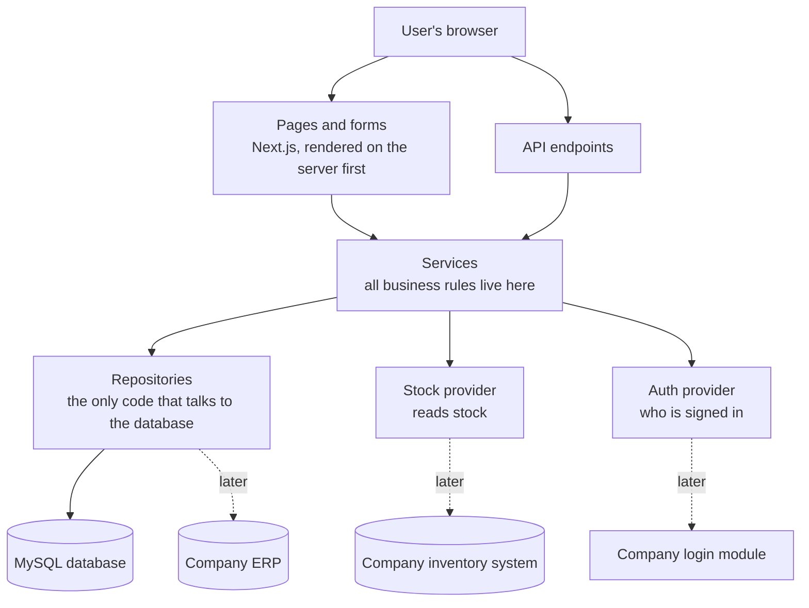

# 4. Under the hood

## The big picture

Solid lines exist or are being built; dotted lines are the **future connections** the SRS asks us to keep possible (NFR-08).

## Why it is built this way

| Choice | Benefit |
|---|---|
| **Server-rendered pages** (Next.js) | Pages arrive with data already in them: faster first view, shareable links, works with the browser's back button |
| **One place for each rule** (services) | The screen, the API and the Excel export cannot disagree about what is allowed |
| **Providers behind interfaces** (login, stock) | When the company's login or inventory system is ready, we replace one file; screens and rules do not change |
| **Repositories** around the database | Moving to the company's ERP database means changing the repositories only |
| **Configuration for every "to be confirmed" value** | When the company answers (number format, time zone, roles), we change settings, not code |
| **Shared validation** | One definition of "valid", used by browser and server |
| **MySQL with strict constraints** | Integrity is protected twice: by the application and by the database (designed by the DB teammate: [data model](../data-model/final-data-model.md)) |

## Quality built in

- **Automated tests** at three levels: unit tests (rules, validation, permissions), integration tests against a real MySQL test database, and end-to-end browser tests of the main journey. A change that breaks a rule fails the build ([DEC-024](../decisions/DEC-024-testing-ci.md)).
- **Continuous checks** on every change: lint, type check, tests and a production build.
- **Accessibility:** the target is WCAG 2.2 AA (provisional) - labelled fields, keyboard use, screen-reader announcements for errors ([DEC-020](../decisions/DEC-020-accessibility.md)).
- **Security basics:** login handled by the company module, permissions checked on every request, no technical errors shown to users, spreadsheet-injection protection in exports.
- **Traceability:** every SRS requirement maps to a decision, a work item and a test ([traceability](../spec/traceability.md)).

## How we work: documents first

Decisions are written before code, one file each. When the SRS was unclear or contradicted itself, we asked, decided and recorded the reason. An AI assistant or a new developer can read [AGENTS.md](../../AGENTS.md) and the docs and continue the work without needing the history of conversations ([DEC-001](../decisions/DEC-001-docs-first-living-docs.md)).

More detail: [architecture overview](../architecture/overview.md) · [decisions](../decisions/README.md)

Next: [05 - Status and next steps](05-status-and-next-steps.md)
