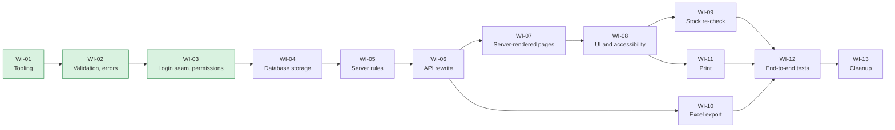

# 5. Status and next steps

> **Keep this page current.** Update it whenever a work item changes status in [the roadmap](../plan/roadmap.md). Last updated: 2026-10-29.

## Where we are, honestly

The application started as a demo (the "MVP") that stores data in files. The review of that MVP against the SRS found it covers most screens but not the safeguards: no login or permissions, rules enforced only on screen, and storage that cannot handle two people at once ([review](../reviews/app-vs-srs-review.md)). We are rebuilding the foundations underneath it in 13 work items, document first.

| Area | State | Notes |
|---|---|---|
| Requirements and decisions | **Done** | SRS in the repo; 26 decisions; 11 SRS conflicts recorded; 27 open questions for the company |
| Developer tooling and automated checks | **Built, partly verified** | npm, Docker database definition, tests, CI definition. Not yet confirmed: starting the database container and the CI run on GitHub |
| Validation, error handling, settings | **Built and tested** | Shared validation rules, the standard error format, time-zone handling, all provisional settings in one place (107 unit tests) |
| Login seam and permissions | **Built and tested** | Pluggable login provider, role/permission table, a dev user switcher, deny-by-default. Verified on a development and a production build (168 unit tests). **Not yet applied to the old screens/endpoints** |
| Real database storage | **Waiting** | The database design is being finished by a teammate; this is the next big step |
| Server-side rules (submit, edit/delete limits, duplicates) | **Planned** | Needs the database |
| Server-rendered pages, new screens, accessibility, responsive layout | **Planned** | After the rules |
| Stock re-check at save | **Planned** | |
| Excel export (streaming) and print layout | **Planned** | The current export works but loads everything in memory and uses a library with known security advisories |
| End-to-end browser tests | **Planned** | |

What this means for a demo today: the **original screens still work** with the old storage, and the new **user switcher** and permission checks can be shown through the API. The behaviours described in pages 2 and 3 are the target; they become demonstrable as the work items land ([demo script](06-demo-and-qa.md)).

## The plan

13 work items, each with acceptance tests ([roadmap](../plan/roadmap.md)):

(Green = built. WI-01 still has two checks outstanding, see above.)

## What we need from the company

These decisions are theirs; until they answer we use the provisional defaults ([all 27](../open-questions.md)). The ones that matter most:

1. **Roles and the permission table** - who may create, edit, submit, delete, export and print.
2. **Indent number and item code formats** - we use `IND-000124` and `ITM-000124` as placeholders.
3. **The real lists** of indent types and departments (the SRS says not to invent them).
4. **Approval integration** - which statuses the approval team sends back, and how.
5. **Login integration** - how the login module tells us who the user is.
6. **Inventory source** - whether stock comes from our own table or the company inventory database.
7. **Editing after submission**, **duplicate items**, **the stock-change warning** - confirm or change our defaults.
8. **Excel and print templates**, if they have a required layout.

## What we need from the team

- The **database owner** to provide sample master data (departments, types, units, items, stock) and confirm the migration runs on MySQL 8.0 ([handoff list](../data-model/db-handoff.md)).
- Docker Desktop running on each developer machine for the local database.
