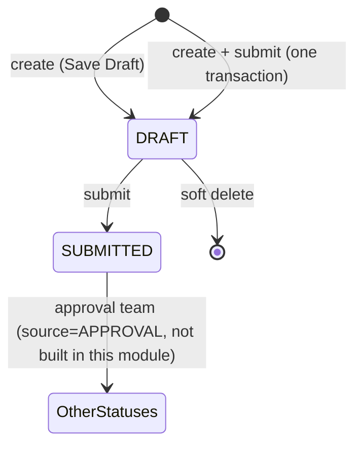

# Domain rules

The business rules the server enforces. Implement them once, in the domain/service layer ([architecture](../architecture/overview.md)), never only in the UI. Provisional items are marked **PROVISIONAL** and point to the decision.

## 1. Lifecycle

| From | To | Who/what | Rule |
|---|---|---|---|
| (none) | DRAFT | `indent.create` | >= 1 line, valid data |
| DRAFT | SUBMITTED | `indent.submit` | Only from a status where `is_editable` is true; stamps `submitted_at/by`; history row |
| DRAFT | deleted | `indent.delete` | soft delete (DEC-008) |
| SUBMITTED | any | not available to users | read-only in this module |

No other transition exists. The client cannot request a status (DEC-005).

## 2. Editable fields (DEC-007, PROVISIONAL)

| Field | Draft | Submitted |
|---|---|---|
| Indent Number, Type, Date, Time, Header Department, Created By | immutable | immutable |
| Remark | editable | read-only |
| Line: item, item code/name/specification/drawing number | immutable | read-only |
| Line: Purpose, Required Quantity, Required Date, Unit, Line Department | editable | read-only |
| Add line / remove line | allowed (never the last line) | not allowed |

## 3. Business rules and where they are enforced

| ID | Rule | Enforced in | Error code |
|---|---|---|---|
| BR-01 / FR-08 | An indent cannot be saved without at least one line | create service; delete-line service (inside the transaction, after locking the header, D-23); UI blocks before call | `INDENT_EMPTY` |
| BR-02 / FR-02 | Indent number is system generated, unique, read-only | number allocator in the create transaction (DEC-010); unique key backstop; no number field in any DTO | n/a |
| BR-03 / FR-06 | Item code is system generated | item create inside the save transaction (DEC-025); no code field in DTOs | n/a |
| BR-04 | Creating an indent never reduces stock | nothing in the indent services writes `stock_balance`; `StockProvider` is read-only | n/a |
| BR-05 | Save = Draft; Submit is a distinct action | create always yields DRAFT; submit endpoint; combined action = DEC-006 | n/a |
| BR-06 | Indent-level attributes are immutable | update DTO has only editable fields; strict schema rejects others | `VALIDATION_FAILED` |
| BR-07 / FR-21 | Delete, Save, Update, Submit need explicit confirmation | UI ([ui.md](ui.md)); not enforceable on the server | n/a |
| BR-08 | Actions restricted by authorization | `authorize()` in every handler ([permissions.md](permissions.md)) | `FORBIDDEN`, `UNAUTHENTICATED` |
| BR-09 | Duplicate items in one indent | **PROVISIONAL**: blocked, flag `ALLOW_DUPLICATE_ITEMS` (DEC-009) | `DUPLICATE_ITEM` |
| BR-10 | Remove an item before saving | **PROVISIONAL**: allowed, client state only (DEC-012) | n/a |
| BR-11 | Editable item fields after creation | **PROVISIONAL**: section 2 table (DEC-007) | `NOT_EDITABLE` |
| BR-12 | Editable fields after submission | **PROVISIONAL**: none (DEC-007) | `NOT_EDITABLE` |
| BR-13 | Search behaviour | **PROVISIONAL**: exact first, then partial (DEC-011) | n/a |
| BR-14 | Stock-change warning | **PROVISIONAL**: non-blocking notice at Save/Submit (DEC-013) | n/a |

## 4. Invariants (hold at all times)

1. Every non-deleted indent has >= 1 line.
2. `indent_number` and `item_code` are unique and never reused, including after soft delete.
3. A Submitted indent's header and lines never change through this module.
4. Every status change has a history row with the actor and source.
5. Every write bumps `version`; a write based on an old `version` fails with `VERSION_CONFLICT` (DEC-016).
6. Referenced masters (type, department, unit, item) are active at the time of the write; later deactivation does not alter old indents (D-10).
7. `required_quantity > 0`; `required_date >= indent_date`.
8. Line snapshots (item code/name/specification/drawing number, stock) are written by the server from the item master and `StockProvider`, never taken from the client (D-21, DEC-013).

## 5. Transaction boundaries

Each of these is one `prisma.$transaction`:

1. **Create:** validate masters -> resolve lines (create new items, snapshots, stock) -> allocate indent number (last step) -> insert header + lines + history -> (if `submit`) submit steps.
2. **Edit header/line, add line, delete line:** lock via versioned `updateMany` (DEC-016) -> change -> verify >= 1 line.
3. **Submit:** lock -> set status, `submitted_at/by` -> history row.
4. **Delete indent:** lock -> set `deleted_at/by`.

On `P2002` for `indent_number`, retry the create transaction once.
